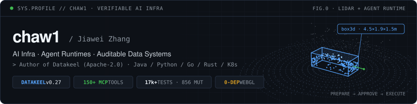

<p align="center">
  <a href="https://hire.jiawis.com">
    <picture>
      <source media="(prefers-color-scheme: dark)" srcset="./assets/banner-dark.svg" />
      <source media="(prefers-color-scheme: light)" srcset="./assets/banner-light.svg" />
      
    </picture>
  </a>
</p>

<p align="center">
  <a href="https://hire.jiawis.com"><strong>hire.jiawis.com</strong></a> ·
  <a href="https://github.com/chaw1/datakeel"><strong>Datakeel</strong></a> ·
  <a href="https://hire.jiawis.com/research/">Research Notes</a> ·
  <a href="mailto:zchaw127@gmail.com">zchaw127@gmail.com</a>
</p>

---

### Now Building · [Datakeel](https://github.com/chaw1/datakeel) (`Apache-2.0`)

An open-source, local-first workbench for **auditable datasets**, **traceable metric Q&A**, and **maker-checker Agent/MCP execution** — zero external keys or databases required to run locally, scaling to PostgreSQL + S3 for teams.

```bash
uv sync --locked && uv run datakeel demo
```

| Dimension | Measured Evidence (`v0.27.0`) |
| --- | --- |
| **Test & Mutation Rigor** | `16,829` Python tests (`97%` coverage, SQLite + PG dual CI) · `1,055` React 19 / TS tests · `856` named mutation anchors & `O(n²)` guards |
| **Controlled Agent / MCP** | `102` FastMCP tools (`37` audited reads + `65` prepare-only) · digest-bound `Prepare → Approve → Execute` · MCP can never self-approve |
| **Data & Evidence Integrity** | Immutable SHA-256 manifests · three-state evidence (`present / absent / unknown`) · optional Rust (`PyO3`) near-duplicate hashing · OpenLineage & Croissant exports |
| **Crash & Load Proof** | `0 lost / 0 dup` under `10,000`-task `SIGKILL` crash recovery · `50`-annotator PostgreSQL save `p95 73 ms` · `168 / 0` fail-closed license audit |

---

### Production Systems Ledger

- **Agent Runtime & Harness Engineering** — Built a `3,000+` LoC in-house Java agent loop (after source-auditing external frameworks out over missing multi-tenancy and remote Skill RCE), exposing `150+` platform tools via MCP with parameter-bound single-use write approvals. Calibrated token attribution across `982` main-chat calls (`0.00%` error) and reordered volatile vs. stable prompt prefixes to cut input tokens **−43.6%** in lab regression (`528` tests green, `6/6` deliberate mutations caught).
- **Multimodal Data Foundation at Scale** — Architected a `SKIP LOCKED` + lease-fencing + Outbox task engine (`10k`-file submit `>2 min → 0.89 s`, `280` retries → `1` version), presigned `1 TiB` multipart ingest with LakeFS version lineage, a `100k`-hour capacity model, a Go watermarked media proxy, and dense-annotation loading cut from `5 min → 2.4 s`.
- **Model Gateway & Cross-Stack Semantics** — Consolidated `16` model services behind a scale-to-zero inference gateway with per-GPU admission control; sped up CPU segmentation `9.4×` (`6,000 ms → 640 ms`); enforced a `40`-format / `213`-extension / `211`-case semantic contract across Java, Python, and frontend CI.
- **Isolation & Cloud-Native / Air-Gapped Delivery** — Moved code execution sandboxing to container boundaries (`NetworkPolicy`, non-root, dropped Linux caps, `seccomp`); shipped `28+` production Deployments under Argo CD GitOps (`3.31M` weekly prod requests, `99.9975%` availability, `p95 50 ms`) and a `27`-image offline platform release to Kunpeng ARM64 + Kylin V10.

---

### Engineering Principles

1. **Measure before tuning** — Attribute every token, query, and millisecond against real counts before touching code.
2. **Kill mutations, not coverage targets** — High coverage with weak assertions is theater; intentionally broken code must turn CI red.
3. **Agents prepare, humans approve** — Every state-mutating agent action freezes its exact scope & digest behind a single-use, idempotent receipt.

---

### Selected Repositories

| Repository | What it is | Stack |
| --- | --- | --- |
| [`chaw1/datakeel`](https://github.com/chaw1/datakeel) | Local-first auditable dataset workbench, compiled metric Q&A & maker-checker MCP runtime | Python 3.12 · FastAPI · PostgreSQL · React 19 · LangGraph · FastMCP · Rust |
| [`chaw1/chaw1.github.io`](https://github.com/chaw1/chaw1.github.io) | Zero-dependency engineering portfolio ([`hire.jiawis.com`](https://hire.jiawis.com)) with hand-written WebGL 128-beam LiDAR & interactive Agent Harness anatomy | Vanilla JS · WebGL2 · Web Workers · HTML / CSS |
| [`chaw1/outfit-agent`](https://github.com/chaw1/outfit-agent) | Multimodal content & wardrobe workflow agent (visual analysis → script → render → publish) | Python · FastAPI · LangGraph · Expo |

---

### Stack

```text
systems & runtime   Java 17 (Spring Cloud, Netty) · Python 3.12 (FastAPI) · Go · Rust (PyO3) · TypeScript
ai & agent infra    MCP / FastMCP · LangGraph · Custom Agent Loops · Prompt Caching & Eval Harnesses · Model Serving
data & storage      PostgreSQL (SKIP LOCKED) · MySQL · MongoDB · Redis · Kafka · LakeFS / S3 · OpenLineage
platform & edge     Kubernetes / k3s · Argo CD (GitOps) · seccomp / NetworkPolicy · Loki / Grafana · WebGL2
```
